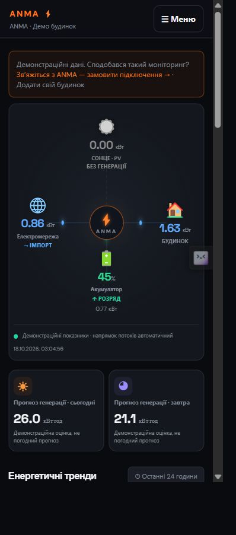

# ANMA Cloud

Home Assistant integration for the ANMA Cloud energy dashboard. Map your existing solar, battery, load and grid entities, preview their current readings, and connect your installation using a short-lived pairing code over Tailscale.

## Як виглядає ANMA Cloud

Інтеграція передає вибрані показники Home Assistant до вебкабінету ANMA Cloud. Нижче — справжні скріншоти вебкабінету з **демонстраційними даними**, а не картка всередині Home Assistant. Реальні показники та історія залежать від підключених сутностей.

### На комп’ютері

Енергопотоки, сонячна генерація, споживання, акумулятор, мережа та графіки за останні 24 години.


### На телефоні — розмір iPhone X

Адаптивний інтерфейс у браузері з областю перегляду **375 × 812 CSS px**. Це перевірка розміру екрана, не знімок із фізичного iPhone. Навігація згортається в меню, енергопотоки залишаються на головному екрані.



[Переглянути мобільний скріншот у повному розмірі](docs/screenshots/dashboard-iphone-x.png)

## Встановлення через HACS — рекомендовано

[Додати ANMA Cloud до HACS](https://my.home-assistant.io/redirect/hacs_repository/?owner=bobantonbob&repository=anma-cloud&category=integration)

1. Встановіть і налаштуйте HACS у Home Assistant.
2. Натисніть посилання вище. Або HACS → меню ⋮ → Custom repositories: URL `https://github.com/bobantonbob/anma-cloud`, тип **Integration**.
3. Знайдіть **ANMA Cloud** у HACS і натисніть Download.
4. Перезапустіть Home Assistant.
5. Налаштування → Пристрої та служби → Додати інтеграцію → **ANMA Cloud**.
6. Відкрийте «Налаштувати», виберіть сутності та збережіть. Пошук показує назву, entity_id і поточне значення.

Поки репозиторій не прийнято до загального каталогу HACS, його необхідно один раз додати як custom repository. Після цього HACS керує встановленням та оновленнями.

## Ручне встановлення

Завантажте ZIP вихідного коду зі сторінки Releases. Скопіюйте папку `custom_components/anma_cloud` до `/config/custom_components/anma_cloud` у Home Assistant (без подвійної вкладеності). Перезапустіть Home Assistant та додайте інтеграцію. Конфігурація наявної інтеграції зберігається при оновленні файлів.

## Підключення кабінету

У налаштуваннях інтеграції відкрийте «Підключення сайту» та створіть одноразовий код. У ANMA Cloud оберіть «Додати будинок», введіть назву, Tailscale IPv4 та код. Код діє 15 хвилин. Сервер кабінету й Home Assistant мають бути доступні через вашу мережу Tailscale; інтеграція сама Tailscale не встановлює.

## Можливості

- PV, навантаження, SOC, потужність і стан акумулятора, мережа, прогнози та лічильники енергії.
- Окремий статус інвертора / Connection, включно з binary_sensor.
- Історія з Home Assistant Recorder; доступність залежить від записаної історії джерел.
- Лише читання вибраних сутностей; немає команд керування інвертором.
- Український та англійський інтерфейс.

## Підтримка

[Контакти та підключення ANMA Electric](https://anma-electric.com.ua/) · [Повідомити про помилку](https://github.com/bobantonbob/anma-cloud/issues)

Не публікуйте ключі, коди підключення, приватні адреси та дампи Home Assistant у issues.

## Development

The integration source is in `custom_components/anma_cloud`. Tests stub Home Assistant host APIs; a real Home Assistant smoke test is still needed for releases.

```sh
python -m pip install voluptuous aiohttp
python tests/test_mapping.py
python tests/test_connector.py
```
