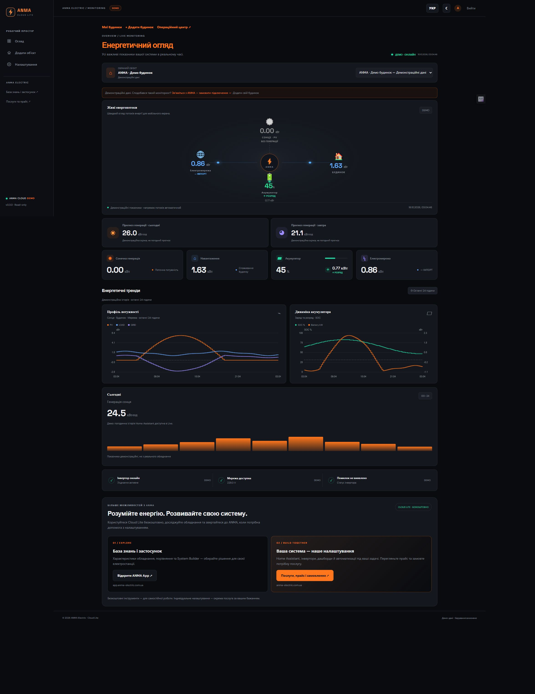

# ANMA Cloud

Home Assistant integration for the ANMA Cloud energy dashboard. Map your existing solar, battery, load and grid entities, preview their current readings, and connect your installation using a short-lived pairing code over Tailscale.

## Dashboard preview

The integration supplies selected Home Assistant readings to the ANMA Cloud web dashboard. These screenshots show the web dashboard with **demo data**, rather than a card inside Home Assistant. Actual readings and history depend on your connected entities. The screenshots show the Ukrainian interface; English is also supported.

### Desktop

Energy flows, solar production, household consumption, battery and grid readings, and charts covering the last 24 hours.



### Mobile — iPhone X viewport

Responsive browser layout at **375 × 812 CSS pixels**. This is a viewport preview, not a capture from a physical iPhone. Navigation collapses into a menu while energy flows remain on the main screen.


[View the full-size mobile screenshot](docs/screenshots/dashboard-iphone-x.jpg)

## Install with HACS — recommended

[Add ANMA Cloud to HACS](https://my.home-assistant.io/redirect/hacs_repository/?owner=bobantonbob&repository=anma-cloud&category=integration)

1. Install and configure HACS in Home Assistant.
2. Follow the link above. Alternatively, open HACS → ⋮ menu → Custom repositories, enter `https://github.com/bobantonbob/anma-cloud`, and select **Integration**.
3. Find **ANMA Cloud** in HACS and select Download.
4. Restart Home Assistant.
5. Open Settings → Devices & services → Add integration → **ANMA Cloud**.
6. Open Configure, select your entities, and save. Entity search shows the name, entity ID, and current value.

Until the repository is accepted into the default HACS catalog, add it once as a custom repository. HACS then handles installation and updates.

## Manual installation

Download the source code ZIP from the [Releases page](https://github.com/bobantonbob/anma-cloud/releases). Copy `custom_components/anma_cloud` into `/config/custom_components/anma_cloud` in Home Assistant, avoiding an extra nested directory. Restart Home Assistant and add the integration. Updating the files preserves your existing integration configuration.

## Connect the web dashboard

In the integration options, open the website connection step and generate a one-time pairing code. In ANMA Cloud, select Add house and enter a name, the Home Assistant Tailscale IPv4 address, and the code. The code expires after 15 minutes. The dashboard server and Home Assistant must be reachable over your Tailscale network; this integration does not install Tailscale.

## Multiple inverters on one Home Assistant

Supported from **v0.4.4**. Add ANMA Cloud again through Settings → Devices & services → Add integration for each inverter. Give each entry a distinct name, then open Configure and map only that inverter's source entities.

Generate a pairing code from each entry separately. Add each inverter as a separate house in the web dashboard, using the **same Tailscale IP address** and its own code. Each entry has independent mappings, credentials, state readings, and history. Revoking one entry does not revoke another.

The web dashboard must also include the multi-inverter pairing update, which allows distinct installation IDs at the same IP address. Existing entries retain their installation IDs and mappings; no removal or re-pairing is required when upgrading.

## Features

- Solar production, household load, battery SOC, battery power and state, grid readings, forecasts, and energy counters.
- Dedicated inverter / Connection status, including binary sensors.
- History from Home Assistant Recorder, subject to the history available for your source entities.
- Read-only access to selected entities, with no inverter control commands.
- English and Ukrainian interfaces.

## Support

[ANMA Electric contacts and setup services](https://anma-electric.com.ua/) · [Report an issue](https://github.com/bobantonbob/anma-cloud/issues)

Do not post secrets, pairing codes, private addresses, or Home Assistant dumps in issues.

[Additional documentation in Ukrainian](README_UA.md)

## Development

The integration source is in `custom_components/anma_cloud`. Tests stub Home Assistant host APIs; a real Home Assistant smoke test is still needed for releases.

```sh
python -m pip install voluptuous aiohttp
python tests/test_mapping.py
python tests/test_connector.py
```
